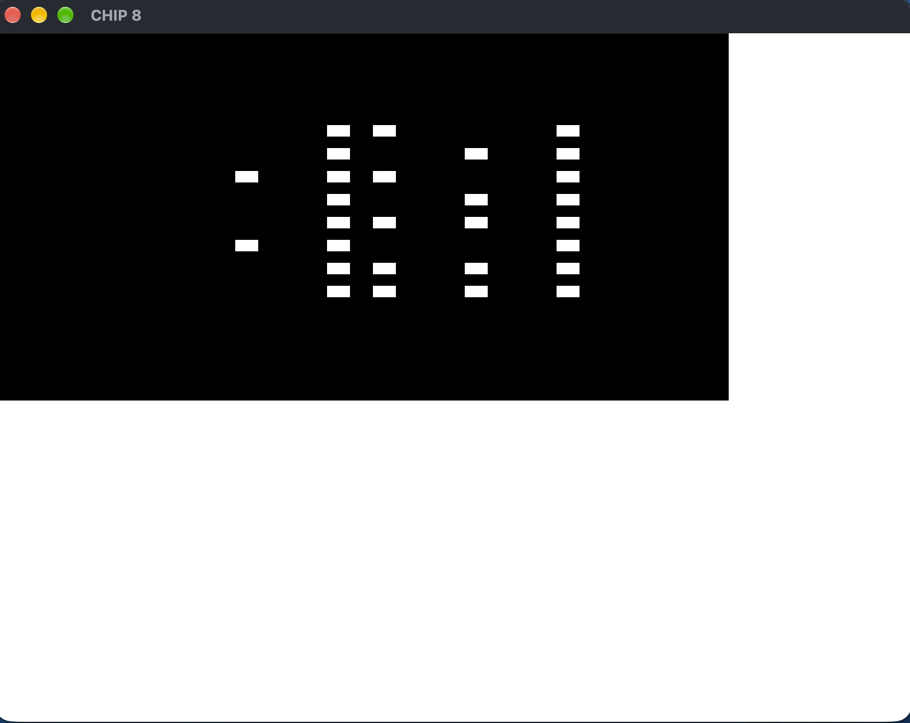

# Rusty CHIP-8

CHIP-8 emulator written in Rust created by following a absolute gem of a resource https://tobiasvl.github.io/blog/write-a-chip-8-emulator, to learn more about the land of emulation.

Uses macroquad for graphics and UI handling.

End goal would be to support the complete CHIP-8 instruction set, and compile it to WebAssembly.

Currently is barely functional can't render the IBM Logo.

#### Expected
.

#### Current
